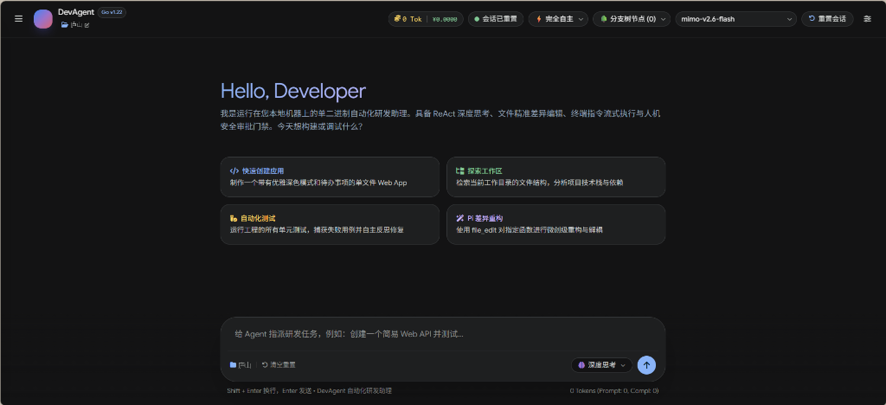

<p align="center">
  <h1 align="center">Autonomous Agent Development Workflow</h1>
  <p align="center">
    <strong>Go言語で構築された世界水準・単一バイナリ自律型AIソフトウェア開発アシスタント</strong>
  </p>
  <p align="center">
    外部ランタイム依存ゼロ • ReAct自律思考・自己修復ループ • 43以上のLLMプロバイダー対応 • 7段階の思考深度コントロール • 3段階HITLセキュリティガードレール • リアルタイム端末ストリーミング • Gitロールバック
  </p>
</p>

<p align="center">
  <a href="https://golang.org/"></a>
  <a href="LICENSE"></a>
  <a href="https://github.com/yfddxwx/Autonomous-Agent-Development-Workflow/actions"></a>
  <a href="https://github.com/yfddxwx/Autonomous-Agent-Development-Workflow/actions"></a>
  <a href="https://github.com/yfddxwx/Autonomous-Agent-Development-Workflow/pulls"></a>
  <a href="https://github.com/yfddxwx/Autonomous-Agent-Development-Workflow"></a>
</p>

---

<p align="center">
  <strong>Language Switcher / 言語切り替え</strong><br>
  <a href="README.md">English</a> •
  <a href="README.zh-CN.md">简体中文</a> •
  <a href="README.ja.md">日本語</a> •
  <a href="README.ko.md">한국어</a> •
  <a href="README.de.md">Deutsch</a> •
  <a href="README.fr.md">Français</a> •
  <a href="README.ru.md">Русский</a> •
  <a href="README.pt.md">Português</a> •
  <a href="README.es.md">Español</a>
</p>

---

## 📖 目次

- [概要](#-概要)
- [主な機能](#-主な機能)
- [システムアーキテクチャ](#-システムアーキテクチャ)
- [Pi準拠の7段階思考深度セレクター](#-pi準拠の7段階思考深度セレクター)
- [Human-in-the-Loop (HITL) セキュリティ](#-human-in-the-loop-hitl-セキュリティ)
- [43以上のモデルプロバイダー対応](#-43以上のモデルプロバイダー対応)
- [クイックスタート](#-クイックスタート)
  - [前提条件](#前提条件)
  - [ソースコードから実行](#1-ソースコードから実行)
  - [単一バイナリのビルド](#2-単一バイナリのビルド)
- [設定ガイド](#-設定ガイド)
- [洗練されたWebインターフェース](#-洗練されたwebインターフェース)
- [テストと品質保証](#-テストと品質保証)
- [コントリビューション](#-コントリビューション)
- [作者とライセンス](#-作者とライセンス)

---

## 🌟 概要

**Autonomous Agent Development Workflow** は、Go言語のみを用いてゼロから構築された超軽量・高性能な単一バイナリ自律型AI開発エージェントです。開発者やエンジニアリングチームのためのローカル常駐型ペアプログラミングパートナーとして機能し、タスクの計画立案、コードの読み書き、シェルコマンドの安全な実行、コンパイルエラーの自律的自己修復、および探索履歴のタイムトラベルを可能にします。

Pythonの巨大な仮想環境やNode.js依存関係を必要とする従来の重厚なフレームワークとは異なり、Go言語の `//go:embed` 機構によりモダンなWebインターフェースを完全内蔵。コンパイル後はわずか **約9MBの単一実行ファイル** となり、ダウンロード後即座に起動できます。

<p align="center">
  
</p>

---

## ✨ 主な機能

1. **外部依存ゼロの単一バイナリ (`//go:embed`)**
   - HTML、Tailwind CSS、オフラインMarkdownパーサー、アイコンをバイナリ内に完全静的埋め込み。Node.jsやPythonは一切不要です。
2. **ReAct自律ループと自己修復機能**
   - `Think -> Act -> Observe -> Reflect` の標準ループを完全実装。ビルドエラーやテスト失敗が発生した場合、標準エラー出力を自律分析し修正コードを反復生成します。
3. **Pi Agent仕様に準拠した7段階思考深度セレクター**
   - プロンプト入力欄に思考深度コントローラーを配置：`オフ (off)`、`最小 (minimal)`、`軽度 (low)`、`中度 (medium)`、`深度 (high)`、`超高 (xhigh)`、`最大 (max)`。
   - モデル特性（DeepSeek V4.1 Flash、Xiaomi MiMo、Claude 3.7、OpenAI oシリーズ、Gemini 3など）を自動検出し、対応レベルのみをインテリジェントに表示。
4. **3段階のHuman-in-the-Loop安全ゲート（HITL Guardrails）**
   - **完全自律 (Auto)**: 安全なサンドボックス環境やCI向け。
   - **限定承認 (Guarded)**: 読み取りやテストは自動実行。ファイル上書き、削除、破壊的コマンド、外部ネットワーク通信は1クリック承認モーダルを表示。
   - **完全承認 (Manual)**: すべてのツール実行に人間による事前承認を要求。
5. **端末実行のリアルタイムストリーミング**
   - シェルコマンドの実行結果をRFC 6455 WebSocket経由でリアルタイムに逐行表示。
6. **Git認識と1秒安全ロールバック**
   - リポジトリの変更状態を検知し、未コミットの変更破棄や未追跡ファイルのクリーンアップをワンクリックで実行。
7. **非破壊セッション分岐ツリー（タイムトラベル）**
   - ターンごとに自動スナップショットを記録。過去の対話ノードにいつでも戻り、新たな分岐を探索可能。
8. **リアルタイムToken・コストメーター**
   - Prompt/Completion Tokenの消費量および日本円・米ドルの推定コストをリアルタイム集計。

---

## 🏗️ システムアーキテクチャ

```text
┌────────────────────────────────────────────────────────────────────────┐
│               内蔵 Google Material 3 Web インターフェース               │
│     (プロンプト入力、思考深度セレクター、セッションツリー、端末ストリーム)      │
└───────────────────────────────────┬────────────────────────────────────┘
                                    │ RFC 6455 WebSockets / REST API
┌───────────────────────────────────▼────────────────────────────────────┐
│                    DevAgent コアエンジン (agent.exe)                   │
│                                                                        │
│   ┌───────────────────────────┐    ┌───────────────────────────────┐   │
│   │     ReAct ループ中核      │◄───┤    マルチプロバイダーハブ     │   │
│   │ (Think-Act-Observe-Reflect)│    │   (DeepSeek, Xiaomi, Gemini,  │   │
│   └─────────────┬─────────────┘    │    Claude, OpenAI, Ollama)    │   │
│                 │                  └───────────────────────────────┘   │
│                 ▼                                                      │
│   ┌───────────────────────────┐    ┌───────────────────────────────┐   │
│   │   HITL セキュリティゲート │    │   セッション永続化・分岐木    │   │
│   │   (パス隔離, 危険コマンド)│    │   (スナップショット, 復元)    │   │
│   └─────────────┬─────────────┘    └───────────────────────────────┘   │
│                 │                                                      │
│                 ▼                                                      │
│   ┌────────────────────────────────────────────────────────────┐       │
│   │                     組込ツール群                           │       │
│   │  file_read • file_write • file_edit • list_dir • cmd_exec  │       │
│   └────────────────────────────────────────────────────────────┘       │
└───────────────────────────────────┬────────────────────────────────────┘
                                    │
                         ┌──────────▼──────────┐
                         │   ホスト OS 環境    │
                         │ ファイルシステム/Git │
                         └─────────────────────┘
```

---

## 🧠 Pi準拠の7段階思考深度セレクター

| レベル | 表示名 | Token予算 | 代表的な適用ケース |
| :--- | :--- | :--- | :--- |
| `off` | **思考オフ** | 0 Tokens | 定型フォーマット変換、直接Q&A |
| `minimal` | **最小思考** | ~1k Tokens | 単一行修正、簡易キーワード検索 |
| `low` | **軽度思考** | ~2k Tokens | スクリプト生成、小規模リファクタリング |
| `medium` | **中度思考** | ~8k Tokens | 標準的な機能実装、コード検証 |
| `high` | **深度思考** | ~16k Tokens | アルゴリズム設計、自己修復テストループ (推奨) |
| `xhigh` | **超高思考** | ~32k Tokens | 大規模アーキテクチャ設計・分析 |
| `max` | **最大思考** | 最大能力 | 難関バグの原因究明、極限推論 |

*思考推論に対応していないモデル（GPT-4oなど）が選択された場合、ボタンは自動的に無効化されグレーアウトされます。*

---

## 🚀 クイックスタート

### 前提条件
- [Go 1.22+](https://golang.org/dl/)（ソースコードからビルドする場合のみ）
- Git（推奨）

### 1. ソースコードから実行
```bash
git clone https://github.com/yfddxwx/Autonomous-Agent-Development-Workflow.git
cd Autonomous-Agent-Development-Workflow

# サーバー起動 (デフォルト: 8080ポート)
go run cmd/agent/main.go -port 8080 -dir .
```

ブラウザで `http://127.0.0.1:8080` を開きます。

### 2. 単一バイナリのビルド
```bash
# Linux / macOS
go build -ldflags "-s -w" -o agent ./cmd/agent

# Windows
go build -ldflags "-s -w" -o agent.exe ./cmd/agent
```

---

## ⚙️ 設定ガイド

`config.example.json` を `config.json` にコピーして設定します（Web画面の「設定」からも入力可能）：

```bash
cp config.example.json config.json
```

設定例：
```json
{
  "active_profile_id": "deepseek-flash",
  "profiles": [
    {
      "id": "deepseek-flash",
      "name": "DeepSeek V4.1 Flash",
      "provider": "deepseek",
      "base_url": "https://api.deepseek.com",
      "api_key": "YOUR_API_KEY",
      "model": "deepseek-flash",
      "max_steps": 15
    }
  ],
  "workspace_dir": ".",
  "approval_mode": "guarded"
}
```

---

## 🧪 テストと品質保証

```bash
go test -v ./...
```

全ユニットテスト・統合テスト・セキュリティゲートテストが100%パスすることを確認しています。

---

## 👤 作者とライセンス

- **作者**: [yifangdong](https://github.com/yfddxwx)
- **リポジトリ**: [Autonomous-Agent-Development-Workflow](https://github.com/yfddxwx/Autonomous-Agent-Development-Workflow)
- **ライセンス**: [MIT License](LICENSE) © 2026 yifangdong
